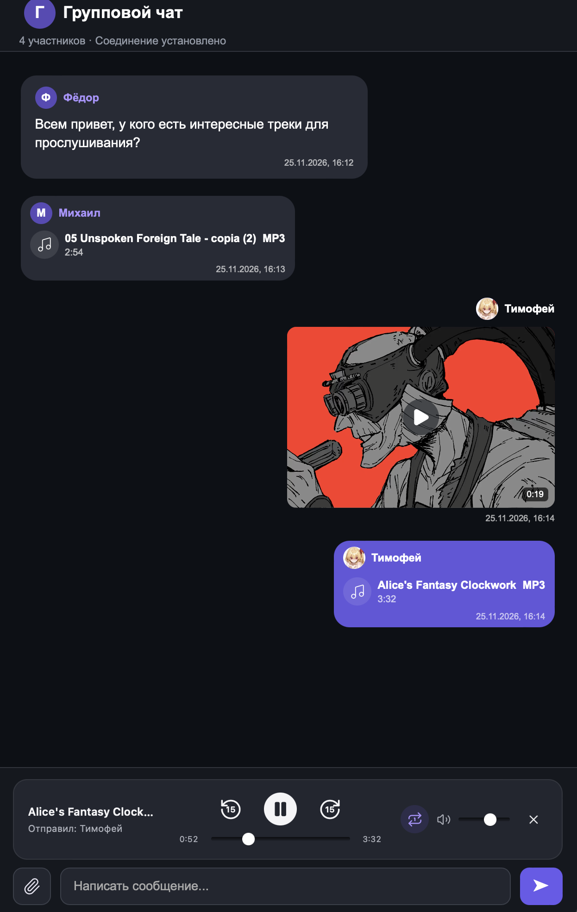
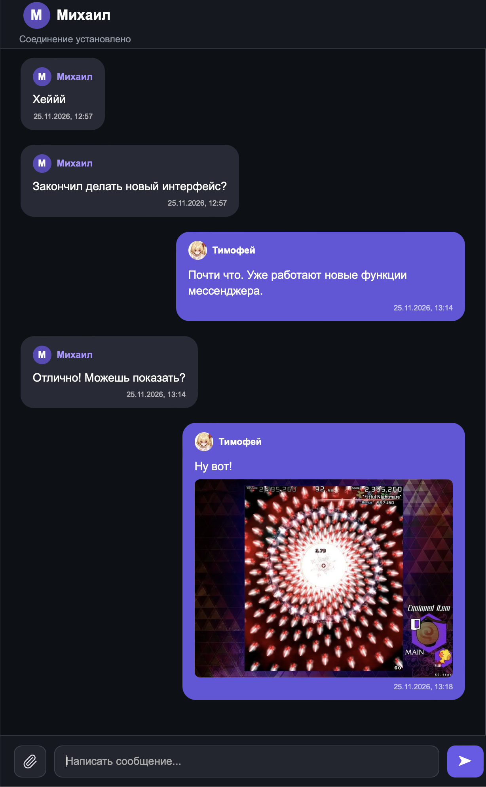
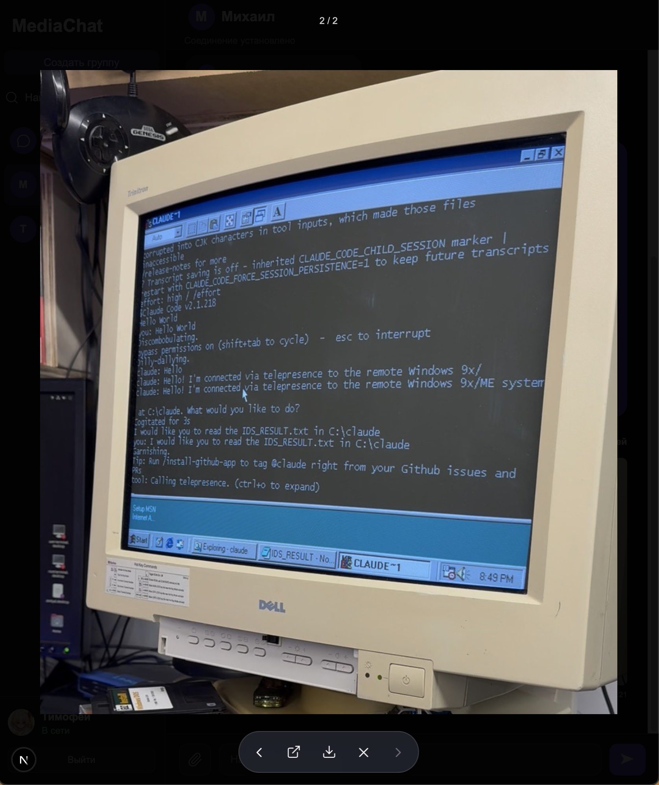
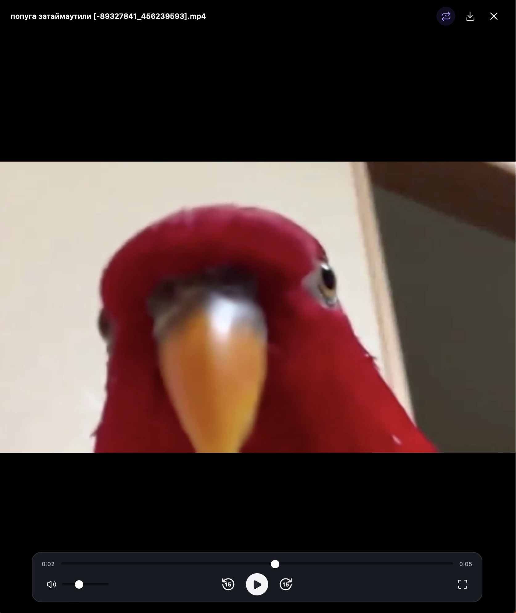
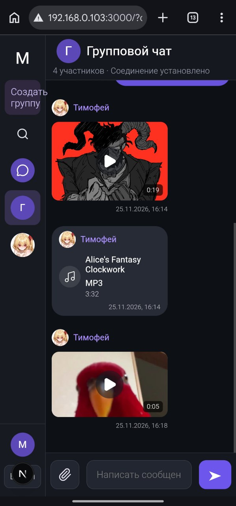
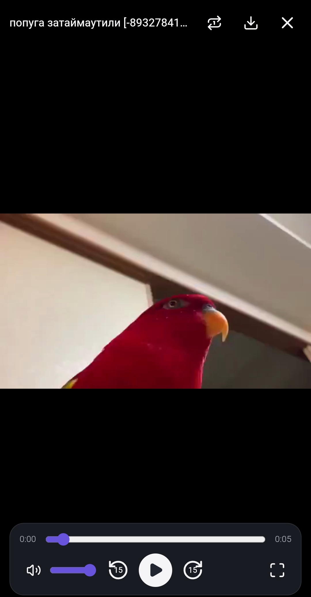

# MediaChat


MediaChat is a full-stack web messenger with real-time conversations, private media sharing, and custom audio and video players. Built as a Junior Full-Stack Developer portfolio project, it covers authentication, relational data modelling, WebSocket communication, file processing, and server-side access control.

The application supports local development, LAN access, and temporary HTTPS demos. It remains under active development and is not presented as production-ready.

<p align="center">
  <a href="docs/screenshots/overview.png">
    
  </a>
  <br>
  <em>Group messaging, media sharing, and audio playback</em>
</p>

## Features

- **Accounts and profiles:** registration, sign-in, user search, profile viewing, and cropped user avatars with live updates.
- **Conversations:** a shared general chat, one-to-one conversations, and groups with owner, administrator, and member roles. Direct conversations are unique per user pair, including concurrent creation requests.
- **Group management:** group names and avatars, participant management, administrator assignment, ownership transfer, leaving, and deletion according to role permissions.
- **Messaging:** real-time delivery across sessions, cursor-based history pagination, conversation previews, and restoration of the selected conversation after reload.
- **Message actions:** copy, quoted replies with navigation, editing text and attachment captions, and deleting your own messages for everyone. Context menus support mouse, keyboard, and long press.
- **Images:** original downloads, optimized WebP previews, a keyboard-navigable viewer, and albums of up to nine images per message.
- **Audio and video:** custom players with seeking, ±15-second controls, volume, and repeat preferences. Videos have generated thumbnails and a fullscreen viewer; protected media routes support HTTP Range requests.
- **Files:** streamed document and archive uploads, original filenames, progress feedback, and authorized downloads. Unsupported media can fall back to downloadable files without transcoding.
- **Attachment workflow:** one menu for all types, multiple selection, previews, cumulative selection, and retained valid files when an individual item fails.
- **Consistency and cleanup:** send acknowledgements and idempotency keys prevent retry duplicates; unused originals and derived files are cleaned up after message deletion.

### Upload limits

| Type | Per-file limit | Processing |
| --- | ---: | --- |
| Images | 25 MiB | JPEG, PNG, WebP, GIF; Sharp validation and optimized previews |
| Audio | 50 MiB | MP3, WAV, FLAC; playback depends on browser support |
| Video | 50 MiB | Supported MP4/WebM codecs; FFprobe inspection, FFmpeg validation and thumbnails |
| Documents and archives | 2 GiB | Streamed storage; supported small files are inspected, large or unsupported files remain download-only |
| User and group avatars | 10 MiB | JPEG, PNG, WebP cropped to 512 × 512 WebP |

Original attachment bytes are preserved; previews and avatars are processed separately. File validation is not an antivirus scan. See [attachment batches](docs/ATTACHMENT-BATCHES.md), [video](docs/VIDEO.md), and [large files](docs/LARGE-FILES.md) for detailed restrictions.

## Stack and architecture

| Layer | Technologies |
| --- | --- |
| Interface | Next.js 16 App Router, React 19, TypeScript, CSS Modules, Tailwind CSS 4, Lucide React |
| Server | Node.js 24 custom HTTP server, Next.js Route Handlers, Socket.IO 4 |
| Data | PostgreSQL 16, experimental Prisma 8 RC contract-based ORM and migrations |
| Authentication | JWT via `jose`, bcrypt password hashes, HttpOnly session cookie |
| Media | Sharp, FFmpeg/FFprobe, private filesystem storage |
| Verification | Node.js test runner, ESLint, TypeScript, HTTP/Socket.IO and Chrome integration scripts |

`server.js` serves Next.js and Socket.IO in a single Node.js process. Route Handlers handle authentication, history, conversation management, and uploads. Socket.IO authenticates sessions and delivers conversation events only to authorized recipients using user and conversation rooms. The client merges history, acknowledgements, and live updates by message ID.

General, direct, and group chats share the same message and attachment infrastructure. PostgreSQL stores users, memberships, messages, replies, and cleanup jobs. Private `uploads/` storage holds originals, derived previews, and attachment metadata; files are delivered through protected API routes rather than a public static directory.

```text
app/
  api/             Authentication, conversations, history, uploads and downloads
  components/      Chat UI, attachment cards, media players and profile/group dialogs
  page.tsx         Main chat interface
src/
  lib/             Access policies, validation, media storage and message utilities
  prisma/          Prisma contract, generated types and database connection
migrations/        Contract snapshots and migration graph
scripts/           Integration checks, media cleanup and temporary HTTPS sharing
tests/            Automated tests
docs/             Technical guides and verification history
```

## Getting started

### Prerequisites

- Node.js 24 and npm. Server modules use native TypeScript execution.
- A running PostgreSQL 16 instance and a database dedicated to MediaChat.
- FFmpeg and FFprobe on `PATH` for video processing and the full test suite.

Use the dependency versions in `package-lock.json`; the experimental Prisma packages use a migration workflow that differs from classic Prisma.

### Install and configure

From the cloned repository:

```sh
npm ci
cp .env.example .env
openssl rand -base64 48
```

Copy the environment template only on a fresh checkout; keep an existing configuration intact. Edit `.env` to set `DATABASE_URL` and use the generated random value for `SESSION_SECRET`. Never commit credentials. Optional FFmpeg paths and maintenance settings are documented in [development and deployment](docs/DEVELOPMENT.md).

### Prepare the database

For a **new, empty database**, inspect the existing migration graph and preview its application before applying it:

```sh
npx prisma migration check
npx prisma db migrate --show
npx prisma db migrate
npx prisma db verify
```

For an **existing database**, inspect its state and migration route first; do not blindly initialize or reset it. This project does not use the classic `prisma migrate dev` / `db push` workflow. See the [database guide](docs/DEVELOPMENT.md#database-workflow) before changing a schema.

### Run locally

```sh
npm run dev
```

Open [http://localhost:3000](http://localhost:3000). Use separate accounts or browser profiles to test messaging. Restart the Node.js process after changing `server.js` or server configuration.

For a phone on the same Wi-Fi network, open `http://<MAC_LAN_IP>:3000`. Development mode allows localhost and the Mac's current private IPv4 interfaces; explicit origins can be configured with `APP_ALLOWED_ORIGINS`. See [LAN access](docs/LOCAL-NETWORK.md).

For a temporary HTTPS demo through localhost.run:

```sh
npm run build:share
npm run share
```

The script prints a temporary public URL and configures its origin. Port 3000 must be free, and the host computer must stay online. This tunnel is a demo tool with no availability guarantee; see [internet access](docs/INTERNET-ACCESS.md).

## Testing

```sh
npm test
npm run lint
npx tsc --noEmit
npm run build -- --webpack
```

The automated suite covers attachment validation and batching, HTTP Range handling, streaming limits, group role permissions, Origin checks, message merging, replies, edits, deletion, and media preferences. Video tests exercise real FFmpeg processing. The suite does not require a running application server or PostgreSQL.

Separate integration scripts test HTTP APIs, Socket.IO, private attachment access, and browser workflows with multiple accounts. They require a configured test database and server; browser checks additionally require Chrome and an externally available Playwright Core installation. They create temporary records and files and must not run against production. See [integration setup](docs/DEVELOPMENT.md#integration-checks).

Recorded checks include LAN Chrome scenarios with three-account direct chats and four-account groups. Real Android/iOS devices, Safari behavior, and physical network interruptions still require manual verification. Historical results and incomplete checks are recorded in the [verification log](docs/V1-PROGRESS.md); they are not a guarantee for every environment.

## Security and deployment status

- JWT sessions use the HttpOnly `mediachat_session` cookie with SameSite=Lax and Secure in production.
- Protected HTTP operations validate origins; Socket.IO authenticates connections. Conversation membership, message authorship, group roles, and attachment permissions are checked on the server.
- File routes enforce size, name, type, and path restrictions. Knowing a private URL does not grant access or permission to republish an attachment.
- Authentication and upload rate limits are implemented in-process. Download-only files use restrictive response headers.
- Private uploads and database credentials are excluded from Git. PostgreSQL must remain private; uploaded files must not be served directly from `public/` or a reverse proxy.

Deployment requires a persistent Node.js server with WebSocket support, HTTPS, an explicit `APP_ORIGIN`, persistent PostgreSQL and upload storage, and coordinated backups. Use `npm start` after building; a standalone `next start` does not initialize this project's Socket.IO server.

Before a public release, remaining work includes trusted proxy/client-IP handling, shared rate limiting for multiple processes, storage quotas, wider device testing, and final operational validation. Uploads are not resumable, files are not antivirus-scanned, and the current implementation is not end-to-end encrypted. A successful build alone does not establish production readiness. See [deployment notes](docs/DEVELOPMENT.md#deployment-and-maintenance).

## Screenshots

### Desktop

| Direct messaging | Image viewer | Video player |
| :---: | :---: | :---: |
| [](docs/screenshots/direct-messages.png) | [](docs/screenshots/image-viewer.png) | [](docs/screenshots/video-player.jpg) |
| Text and image sharing | Gallery navigation and original downloads | Playback and 15-second seeking |

### Mobile

<table>
  <tr>
    <td align="center" width="50%">
      <a href="docs/screenshots/mobile-chat.jpg"></a>
      <br>
      <em>Group chat and media attachments</em>
    </td>
    <td align="center" width="50%">
      <a href="docs/screenshots/mobile-video.jpg"></a>
      <br>
      <em>Video playback with touch controls</em>
    </td>
  </tr>
</table>

## Documentation

The README and development guide are in English. Feature guides and the historical verification log are currently in Russian.

- [Development, migrations, deployment and maintenance](docs/DEVELOPMENT.md)
- [Local network access and Origin configuration](docs/LOCAL-NETWORK.md)
- [Direct conversations and access control](docs/DIRECT-MESSAGES.md)
- [Avatars, groups and role permissions](docs/AVATARS-AND-GROUPS.md)
- [Attachment selection, albums and fallback behavior](docs/ATTACHMENT-BATCHES.md)
- [Video processing and playback](docs/VIDEO.md)
- [Large files and reverse proxy settings](docs/LARGE-FILES.md)
- [Message actions](docs/MESSAGE-ACTIONS.md) and [deletion and cleanup](docs/MESSAGE-DELETION.md)
- [Temporary HTTPS access](docs/INTERNET-ACCESS.md)
- [Development and verification history](docs/V1-PROGRESS.md)
